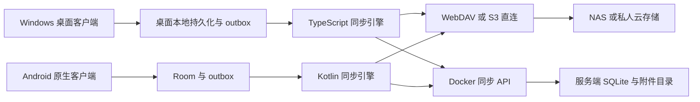

# NAS 私人云同步与 Android 客户端开发方案

日期：2026-10-13。基线：桌面端 3.0.2，提交 e6a8faf。已确认范围：使用 Android 原生 UI 的 Kotlin 客户端、WebDAV 与 S3 直连、可选 NAS Docker 同步服务。版本号和工期为规划建议。

2026-10-14 范围更新：用户已确认桌面 Electron/Vue、移动 uni-app x、Cordis 插件内核；桌面覆盖 Windows、macOS、Linux，移动定位轻量配置、同步、远程控制与基础编辑。总体边界与实施顺序以[整体架构](整体重构架构与实施方案.md)、[完整开发文档](重构开发文档/README.md)和[实施清单](整体重构实施清单.md)为准。本文下方 Kotlin/Compose 独立客户端与 10 至 14 周估算均为历史局部方案，不再作为当前选型和整体工期承诺；设备信息与 NAS 排查经验仍可参考。

建议先补齐跨设备同步的可靠性，再交付 Android 写作客户端，最后提供 Docker 服务和扩展功能。所有编辑先持久化到本机，网络同步作为独立流程；用户在 NAS 不可达、手机断网和应用重启后都能继续写作。首版服务面向一个作者的多设备使用，同一章节发生并行修改时保留双方内容并让作者处理。

## 首轮验证设备与准备工作

| 项目 | 已确认信息 | 准备事项 |
| --- | --- | --- |
| NAS | 用户自组设备，运行飞牛 OS | 建立专用测试目录和限定权限账号，确认 Docker 可用；实施时记录 fnOS 版本与 CPU 架构 |
| 手机 | 用户提供：小米 15 Pro，澎湃 OS 4，Android 17 | 开启开发者选项与 USB 调试，通过数据线连接开发电脑，授权电脑调试 |
| 开发电脑 | Windows，已有 Git、Node、npm、Java 21；Android Studio 尚未安装 | 安装 Android Studio 稳定版，通过向导与 SDK Manager 配置 SDK、Platform-Tools 和构建工具 |
| 测试网络 | 首轮采用同一局域网 | 手机、电脑与 NAS 互相可达，记录 NAS 局域网地址；外网访问放到后续验证 |

首轮以真机测试为主，模拟器作为不同 Android 版本的补充。Android 17 是当前测试设备的系统版本，不等于应用仅支持 Android 17；最低支持版本和编译目标在原生工程建立时明确。

小米真机额外验证锁屏、切后台、省电状态、系统回收进程和网络恢复时的保存与同步行为。先记录系统默认状态的测试结果，再判断是否需要给用户提供后台限制的设置指引；不把持续后台运行当作已实现能力。

NAS 测试使用作品副本与独立目录。容器持久卷、端口、WebDAV 路径和 S3 测试实例在对应验证阶段配置。密码、令牌和密钥保存在本机配置中，方案只记录非敏感环境信息。

## 当前基础与需要补齐的能力

3.0.2 已有 WebDAV 和 S3 直连，新增工作主要是跨端可靠性、增量协议、移动界面和自托管服务。

| 现有实现 | 可以复用 | 需要改造 |
| --- | --- | --- |
| `src/lib/sync/webdavTransport.ts`、`s3Transport.ts` | 地址配置、协议通道、请求签名思路 | 抽出平台网络桥，传递 ETag 与条件请求头，统一错误分类 |
| `src/lib/sync/syncRemoteCore.ts` | 远端不存在、读失败、损坏的区分 | 当前先读 rev 再无条件 PUT，回读只比较 rev；两端写出相同 rev 时仍可能覆盖。需要服务器原子条件写入 |
| `src/lib/sync/syncCore.ts` | 三路合并思路、冲突副本、空推防护 | 整库快照改成项目及实体增量；持久化基线与待上传操作；成功保存由本地持久化决定 |
| `src/lib/sync/desktopCloudSync.ts` | 同步配置与状态展示 | 当前启用受 DESKTOP 限制，凭据存 localStorage；需跨平台配置与凭据适配 |
| `src/lib/storage/storeOps.ts`、`src/lib/db/*` | 数据访问门面和大部分业务接口 | 加入事务式业务写入、同步元数据及日志；保持原接口迁移兼容 |
| `src/lib/sync/syncTombstone.ts` | 删除记忆思路 | 当前墓碑在本机 localStorage；新版删除操作要参与同步并有保留与回收规则 |
| `src/lib/storage/sidecar.ts` | 外置大块数据抽象 | 统一图片、知识库原文等附件的同步清单；向量缓存与备份另定策略 |
| `src/lib/schema*`、`src/lib/types.ts`、`src/lib/ai*` | 字段规范、领域模型、AI 提示词与上下文规则 | 导出声明式字段定义与协议契约；Android 以 Kotlin 实现相同行为，不直接执行 TypeScript 业务代码 |

现有资料需要区分项目级与全局级数据。例如 formData 的真实键为 `projectId::tabId`，不能仅用 tabId 作为跨端记录身份。worlds 等全局资料也不能在项目删除时一起清除。

## 产品形态与技术选择

| 部分 | 建议 | 原因 |
| --- | --- | --- |
| Windows 桌面 | 保留 React 与 Electron | 延续现有编辑体验和文件能力 |
| Android 界面 | Kotlin、Jetpack Compose、Material 3；必要时使用 Android View 控件 | 独立原生界面，直接接入 Android 输入、布局与生命周期 |
| Android 本地数据 | Room 管理应用私有目录内的 SQLite，DAO 加 Repository | 事务保存正文、同步基线和 outbox，提供数据库迁移与可观察查询 |
| Android 状态与任务 | ViewModel、Coroutines、Flow、WorkManager | 前后台共用 Kotlin 业务层，编辑状态与后台任务分别管理 |
| Android 网络与系统能力 | Kotlin 网络模块、Keystore、系统文件选择器 | 实现 WebDAV、S3 签名与同步 API，直接管理证书和凭据 |
| Docker 服务 | Node.js LTS、TypeScript、Fastify、SQLite、文件附件目录 | 与项目语言一致，单实例自托管部署易维护 |
| NAS 部署 | Docker Compose，发布 amd64 和 arm64 镜像 | 面向常见 x86 与 ARM NAS；具体机型仍需实测 |

Android 是独立的 Kotlin 应用。页面、正文输入和业务逻辑均在原生工程实现，不使用 Capacitor、WebView 或嵌入 JavaScript 引擎承载创作功能。Windows 保持现有 React 与 Electron 实现，两个客户端通过统一数据契约与同步协议互通。

Compose 是 Android 官方推荐的原生 UI 工具，能够与 Android View 控件互操作。正文编辑在 P0 对 Compose 原生文本输入和 EditText 做中文输入、选区及长文性能验证，再选定实现；其余页面使用 Compose。[Compose 官方说明](https://developer.android.com/compose)、[View 互操作说明](https://developer.android.com/develop/ui/compose/migrate/interoperability-apis/views-in-compose)

Android 使用 Room 管理 SQLite，编辑页面和后台 Worker 通过同一 Repository 与数据库访问业务数据、基线、outbox 和 inbox。保存业务数据与登记操作日志必须属于同一事务；验证数据库升级、进程终止恢复与并发访问。[Room 官方说明](https://developer.android.com/training/data-storage/room)

前台手动同步与 WorkManager 调用同一个 Kotlin SyncEngine。它可上传操作、拉取变更、自动合并不同实体或互不冲突字段；需作者决定的冲突保留双方版本并在下次打开应用时展示。任务采用工作区级串行调度、数据库状态守卫与幂等操作，防止前后台同时提交。后台不得去掉条件请求头强行覆盖。[Android 离线架构说明](https://developer.android.com/topic/architecture/data-layer/offline-first)

WorkManager 适合持久化同步任务，支持约束条件和重试，但执行时间由系统调度；被用户强制停止后要等再次启动恢复。首版前台同步为必须能力，后台同步在发布验证前完成。[Android 后台任务文档](https://developer.android.com/develop/background-work/background-tasks/persistent)

## 两种同步模式

两种模式共用实体身份、版本、操作格式、冲突规则和加密封装；传输和提交机制分别实现。桌面 TypeScript 引擎与 Android Kotlin 引擎遵循同一规范，通过相同测试样本验证行为一致。一个工作区同一时刻只选择一个权威同步后端。更换后端通过导出、核对、迁移完成，不同时向两个独立后端双写。

**直连模式**：用户填写 WebDAV 地址与账号，或 S3 端点、桶和凭据，无需安装服务。首批验证 Nextcloud WebDAV、一个真实 NAS WebDAV 服务，以及 MinIO S3；其他兼容服务逐个加入测试矩阵，不能仅凭“兼容协议”宣称实测支持。

**Docker 模式**：用户在 NAS 上安装一个服务，客户端填写地址并配对。服务负责设备授权、版本条件检查、变更游标、操作去重、附件管理、历史保留和恢复。直连存储用户可以后续迁入 Docker 模式。

Docker 首版使用 NAS 本地持久卷承载 SQLite，远程 S3 作为后续可选附件后端或备份目标。SQLite 不部署在 WebDAV、S3 挂载或跨机器共享文件系统上，也不做多副本并发写；服务升级先备份并验证数据库迁移。

## 本地保存与同步协议

1. 用户编辑后，在同一次本地事务中写业务数据和待上传操作。
2. 本地事务成功后显示“已保存到本机”；同步状态单独显示“待同步”。网络失败不改变本机保存结果。
3. 同步引擎读取远端版本或变更游标，并持久化收到的变更与基线。
4. 与本机未上传操作做三路合并；生成可以提交的变更，冲突内容另存。
5. 上传缺失附件，再提交实体操作；远端确认后才移除或标记对应 outbox 操作完成。
6. 若确认响应丢失，按同一 opId 重试；已提交操作不能重复应用。

建议操作携带以下字段：

| 字段 | 用途 |
| --- | --- |
| `workspaceId`、`scopeId` | 区分用户工作区、项目或全局资料 |
| `store`、`entityId` | 稳定实体身份，明确项目级复合键 |
| `opId`、`deviceId`、`deviceSeq` | 幂等重试、设备来源与本设备顺序 |
| `baseVersion`、`newVersion` | 判断修改所依据的版本，避免用设备时间决定胜负 |
| `kind`、`body` 或 `blobRefs` | 创建、修改、删除及其内容 |
| `batchId`、`protocolVersion` | 关联需要原子提交的变更及协议兼容 |

本地持久保存各实体的已同步基线、当前内容、待上传操作及工作区 epoch。重复点击、网络超时、手机重启不能产生重复章节。网络状态只决定什么时候尝试同步，不能作为同步成功的证据。

现有 StoreOps 只有单条与批量原语，不能表达跨表事务。需新增领域事务入口，将删除章节与联动总表、创建项目与默认资料等跨表操作组成一个批次。提交远端前，在客户端验证批次依赖和引用完整性；迁移期间桌面 JSON 后端采用单次原子写保存数据及 outbox，Android 与服务端采用 SQLite 事务。

## 直连存储的并发提交

先做连接能力探测：认证、路径存在、读权限、创建测试对象、写权限、清理权限、ETag、条件写入是否被服务端实际执行。测试在专属随机临时路径进行。不能把“GET 成功”当成完整同步能力通过。

过渡版本先给现有快照增加 ETag 条件写入，再开发增量格式：更新对象使用 `If-Match`，首次创建使用 `If-None-Match: *`；409 或 412 触发重新拉取、合并及有限次数重试。必须验证“故意使用旧 ETag 的写入会被拒绝”，同时检测首次创建竞争。若服务端没有可用于 If-Match 的强 ETag，或忽略条件头，新版自动推送不可启用，可保留离线编辑和只读拉取，并提示使用 Docker 服务。

WebDAV 的 ETag 与条件请求遵循其 HTTP/WebDAV 约定。[WebDAV 标准](https://www.rfc-editor.org/rfc/rfc4918.html) Amazon S3 支持 If-Match 与 If-None-Match 条件写入，兼容实现必须逐一验证，S3 字样本身不能保证同等行为。[S3 条件写入文档](https://docs.aws.amazon.com/AmazonS3/latest/userguide/conditional-writes.html)

新版远端建议采用隔离目录 `yfe-sync-v2/<workspaceId>/`：

- 工作区 manifest 保存协议版本、工作区身份、项目目录与全局资料入口，用条件写入更新。
- 每个项目 manifest 指向当前提交、基础检查点和变更批次。并发控制至少以项目为单位，项目内再按实体规则合并。
- 不可变提交文件记录批次和父版本；正文与附件独立上传，上传完成后才通过条件写入发布 manifest。
- 附件标识采用内容校验标识；开启端到端加密后使用密文校验标识或带密钥的标识，避免公开明文指纹。
- 工作区 manifest 已登记但项目 manifest 缺失，视为损坏或未完成创建，不能自动当作一个新的空项目覆盖。
- 尚未发布的上传对象是孤儿候选。经过保留期并确认不被任何有效 manifest 或历史引用后才能回收。

索引与实体提交之间不依赖“所有对象一次写完”的假设。先上传全部不可变对象，最后发布引用它们的 manifest；断电或断网最多留下可清理的孤儿对象，不暴露半个项目。

## 冲突与删除规则

| 场景 | 处理规则 |
| --- | --- |
| 两端修改不同章节 | 自动合并 |
| 两端修改同一卡片的不同字段 | 基于共同基线合并，字段删除同样参与比较 |
| 两端修改同一字段 | 保存双方版本，显示冲突入口 |
| 同一章节正文两端修改 | 首版保留双方全文与共同基线，作者选择或手动合并 |
| 一端删除另一端修改 | 保留删除事件和修改稿，要求作者处理 |
| 同时移动、重排章节 | 保留双方操作，验证归属及排序；不能仅拼接两个数组 |
| 删除项目、卷、章节 | 使用版本化墓碑和关联操作批次，先进入可恢复状态 |
| 长期离线设备重连 | 若游标或基线过期，完整重同步，并把离线稿留作待合并内容 |

不使用“最后设备时间较大者胜出”作为正文合并规则，也不自动采用本地优先并隐藏远端修改。默认按单作者多设备设计，实时共同编辑和 CRDT 可在后续有明确协作需求时评估。

墓碑回收须结合服务端确认进度或客户端有效期策略。撤销或长期未使用的设备回归时先完整重同步，防止被删记录重新出现。设备时间只用于展示，版本关系由提交链与服务游标决定。

## 同步数据范围

| 数据 | 首版策略 |
| --- | --- |
| 项目、卷章、正文、大纲、角色、关系、伏笔、时间线 | 同步，支持按项目选择下载 |
| 世界包及其不可变版本 | 作为全局资源单独同步，项目保存引用 |
| 角色图片、地图图片 | 附件化，按需下载、缓存和校验 |
| 手机创建的灵感记录 | 接入现有灵感素材，稳定 ID，跨端可编辑 |
| 资料库原文 | 后续按需同步；首版已有资料可保留在桌面，不删除 |
| 向量索引与嵌入缓存 | 作为本地派生数据，不上传，按设备重建 |
| 自动备份、备份载荷 | 本机独立保留；NAS 恢复点由独立策略产生 |
| 章节快照、冻结版本、酒馆记录、AI 账本 | 分类设置保留策略，分阶段支持；未支持的记录必须原样透传或保留，不能被手机回写清除 |
| API Key、网盘凭据、设备私钥、主题缩放和设备偏好 | 保存在设备上，不进入工作区同步载荷 |

同步让多设备看到当前状态，备份用于恢复误删和损坏，两者分别提供。Docker 首版安排每日检查点，建议默认保留 30 天，并提供可配置上限、手动恢复和离线导出。只有桌面数据库和附件完整备份通过恢复演练后，才宣称该策略可恢复。

## Android 首版交互

采用独立原生手机布局：底部导航为作品、写作、资料、灵感、设置。桌面的大侧栏和表格不直接缩放到手机上。Compose 页面通过 ViewModel 暴露状态和事件，正文输入组件维护文本、选区及输入法组合态，Repository 负责持久化。

| 首版功能 | 具体行为 |
| --- | --- |
| 作品与章节 | 选择同步作品，查看卷章树，打开上次章节 |
| 离线写作 | 创建章节、正文编辑、标题修改、字数统计、自动保存、撤销重做 |
| 阅读与资料查询 | 阅读大纲、角色、世界设定，支持本地关键字搜索 |
| 灵感收集 | 快速文字记录，关联作品并进入同步队列 |
| 同步管理 | 配置直连或 Docker，手动同步、Wi-Fi 限制、待同步数量、冲突入口 |
| 恢复 | 本机草稿恢复、冲突稿查看、最近快照与项目导出 |

下一阶段加入简单设定编辑、云端 AI 续写与改稿；手机上的 AI 凭据独立配置，Android 用 Kotlin 实现桌面相同的上下文规则，并通过共用测试样本验证保密过滤、预算和防剧透行为。提示词和字段说明作为声明式资源复用。调用 NAS 上的模型须单独配置可达地址，桌面 `localhost` 配置不能直接复制给手机。

地图绘制、关系图复杂编辑、完整拆书和大型酒馆功能放入后续阶段。首版手机的精简界面只限制可操作功能，不限制它保留数据的能力。

输入验证包含中文输入法组合态、选区、撤销、长章节、键盘遮挡、系统返回键和切后台。文本变化先进入本机草稿缓冲并尽快持久化，显示“已保存”必须有持久化完成回执；不能只在退出页面时保存。后台或被强制终止时可能仍有尚未确认的输入，需按保存时延指标和故障测试约束。

Room 发出已保存正文时，不得每次将整段文本重新写入输入控件，以免中断输入法组合、重置选区或跳动光标。保存任务带章节 ID 与草稿序号，串行提交；迟到的保存结果不能覆盖更新的草稿。发生远端正文修改时，先保留本机正在编辑的草稿，再合并或显示冲突。

## Docker 服务与配对

首版服务提供以下 API 能力，路径为规划示例：

| API | 职责 |
| --- | --- |
| `GET /health`、`GET /capabilities` | 健康状态、协议版本、功能能力 |
| `POST /pairings`、`POST /devices` | 短期配对码、设备登记、独立令牌 |
| `GET /changes?cursor=...` | 按工作区读取变更，支持分页及游标过期提示 |
| `POST /commits` | 事务提交批次，检查 baseVersion，按 opId 去重 |
| `PUT /blobs/:id`、`GET /blobs/:id` | 校验附件、下载与重试 |
| `GET /conflicts`、`POST /resolutions` | 查询冲突元数据、提交解决操作 |
| `GET /checkpoints`、`POST /restore` | 恢复点列表与显式恢复 |
| `GET /devices`、`DELETE /devices/:id` | 查看和撤销设备 |

服务端一个事务提交实体版本、操作去重记录和 change cursor；请求确认丢失后，重复提交相同 opId 返回原结果。加密工作区里正文合并在客户端进行，服务器仅验证可见版本元数据并保留加密冲突版本。

提供 Compose 示例、持久卷说明、反向代理 HTTPS 示例、升级步骤与恢复步骤。数据库备份使用 SQLite 在线备份机制或停服务后一致复制，附件须与所备份检查点对齐；不能只复制一个正在写入的数据库主文件。服务只在用户部署环境内运行。外网访问建议通过用户已有 VPN 或 HTTPS 反向代理；应用不承诺绕过 NAS 的网络可达性限制。

初始管理员凭据一次性设置；每台设备有独立令牌，可单独撤销。二维码配对承载服务地址与短期一次性配对码，不直接放长期 NAS 密码。直连模式的连接信息与加密密钥分开转移，连接二维码默认不含凭据。

## 凭据与加密

当前公开常量 `DEFAULT_CLOUD_KEY` 无法提供每个用户独立的保密性。新版使用用户独立密钥；需要端到端加密时，客户端用随机数据密钥加密内容，再通过用户口令或恢复密钥保护数据密钥。KDF 参数须版本化并在目标手机测试耗时；禁止无提示降级为 XOR。

Android 通过 Keystore 中的密钥保护本机保存的网盘凭据、设备令牌和数据密钥。Keystore 保存的是密钥，应用用它加密凭据后再保存密文。[Android Keystore 文档](https://developer.android.com/privacy-and-security/keystore)

桌面端新增 CredentialStore 适配，使用操作系统保护机制，迁移现有 localStorage 凭据。端到端加密配置、恢复密钥、换机流程和忘记密钥的后果必须在首次配置时讲清楚；服务器重置登录密码不能解密旧内容。

自建 NAS 证书支持导入专用 CA 或确认并固定证书指纹，限定到配置的端点。手机与桌面的所有网络请求采用一致证书策略；不全局关闭 TLS 校验。服务日志不记录正文、Authorization、NAS 密码或 API Key。

## 代码改造边界

建议保留一个仓库，新增独立 Gradle Android 工程；桌面与服务端继续使用 npm 工具链。渐进整理现有 TypeScript 模块，避免同时搬动全部已有文件。

| 建议目录或模块 | 内容 |
| --- | --- |
| `contracts` | 协议与 JSON Schema、OpenAPI、声明式字段资源、跨语言测试样本 |
| `packages/domain` | 供桌面与服务端使用的 TypeScript 领域类型、纯函数和版本兼容 |
| `packages/sync` | 桌面 TypeScript 同步实现、实体版本、操作队列、检查点与传输接口 |
| `src/lib/platform` | Runtime、LocalStore、CredentialStore、NetworkClient、FileAccess、TaskScheduler 接口 |
| `src/lib/platform/desktop` | 桌面桥与 JSON 持久化迁移，后续评估桌面 SQLite |
| `android/app` | Kotlin 应用入口、Compose 导航、原生页面、ViewModel 与依赖装配 |
| `android/core/model` | Kotlin 领域模型、字段资源解析与数据兼容 |
| `android/core/database` | Room Entity、DAO、数据库迁移与 Repository |
| `android/core/network` | WebDAV、S3 签名、同步 API、证书及网络错误分类 |
| `android/core/sync` | Kotlin SyncEngine、三路合并、WorkManager、操作队列与附件 |
| `android/feature/*` | 作品、正文编辑、资料、灵感、设置和冲突处理 |
| `services/sync-server` | Docker 服务、数据库迁移、API 与附件存储 |
| `deploy` | Compose、反向代理和备份恢复示例 |

现有 `db.ts`、`schema.ts`、`ai.ts` 保留桌面门面，逐步转向 TypeScript 模块。Android 不需要实现 JavaScript StoreOps 桥，直接使用 Kotlin Repository；两端在协议层交换数据。构建分别产出桌面包、Gradle 签名 APK 和容器镜像。

共用的是数据格式、字段 ID、提示词资源、协议和测试样本。React 组件不能直接用于 Android；TypeScript 的冲突合并、上下文裁剪、编号与字数算法需要按首版范围移植到 Kotlin。每增加一项手机功能，要同时补充一致性样本，不能只按名字重新实现。

定义统一 JSON 序列化、UTF-8、换行、版本校验、加密封装与签名规范，提供中文、空字段、未知字段、删除冲突和排序操作样本。TypeScript 与 Kotlin 分别读取同一输入，验证等价输出；两端交叉加密解密，验证口令派生、nonce、AAD 和附件校验。生成 DTO 时保留未知字段，Room 的原始载荷与类型化投影分开管理；新增手机字段不能导致旧字段丢失。

## 迁移与版本兼容

新版同步协议使用独立 v2 目录与协议标识。旧 `.yfe` 只作为迁移输入或旧模式数据源，不能让 3.0.2 与新版对同一工作区同时写入。首先提供只读解析和项目统计，再建立 v2 工作区，核对项目、章节、正文校验和与附件，完成后切换。

将本机数据文件版本、IndexedDB 版本、同步协议版本、服务 API 版本分开管理。手机或桌面遇到不认识的新协议必须停止推送并提示升级；不支持的业务字段要保留，不能解码后丢字段再上传。

支持导出回桌面可识别的项目包，但新增数据的降级损失要明确提示。返回旧版时使用迁移前备份或明确导出的兼容副本，不能假设旧版会完整读取 v2。更换同步后端、新设备首次拉取和恢复备份都要有明确的工作区身份与 epoch，防止旧队列覆盖新工作区。

## 开发阶段与交付门槛

以下为一名熟悉 React、Node 和 Kotlin Android 原生开发的开发者的初步估算，不是承诺工期；真实 NAS、目标手机和 Android 构建环境会影响进度。原生首版需要单独实现界面和 Kotlin 业务逻辑，含两种模式及端到端验收预留约 10 至 14 周。可先发布直连模式的 Android 内测版。

| 阶段 | 参考工作日 | 交付内容 | 进入下一阶段的条件 |
| --- | --- | --- | --- |
| P0 技术验证 | 5 至 7 | Gradle 原生工程、Room 事务、Compose 与 EditText 中文编辑验证、WebDAV 与 S3 CAS 探测、协议草案 | 手机杀进程恢复通过，旧 ETag 写入被拒绝，JSON 与加密样本跨语言往返正确 |
| P1 同步基础 | 10 至 14 | TypeScript 与 Kotlin 同步引擎、本地操作队列、持久基线、幂等操作、墓碑、冲突规则、v2 直连协议 | 共用协议样本通过，双设备并发、断网重试、删除重连均无静默丢稿 |
| P2 Android 首版 | 12 至 18 | Compose 原生页面、正文编辑、资料查询、灵感、同步设置与冲突页面、APK | 手机和桌面完整往返，未支持数据保留，中文编辑与长文性能满足指标 |
| P3 Docker 模式 | 6 至 10 | API、配对、设备撤销、附件、检查点、Compose 和双架构镜像 | 幂等重试、服务重启、备份恢复和客户端切换通过 |
| P4 发布验证 | 8 至 12 | Room 数据库迁移、旧库迁移、中文输入、兼容矩阵、后台任务、签名 APK、桌面更新与说明 | 通过跨语言一致性、故障注入、端到端验收和恢复演练 |

Android UI 原型可在 P1 期间搭建，正式跨端同步必须在 P1 验收后接入。前台同步为 P2 必须项，原生后台 outbox 与 inbox 在 P4 完成；后台任务故障不能影响前台本地保存。P3 默认部署单实例，后续再评估多人授权、服务端全文检索与更大规模数据库。

## 验收用例与性能目标

首版至少覆盖以下端到端场景：

1. Windows 写入，Android 拉取并继续编辑，再回到 Windows，正文、标题、顺序和引用保持一致。
2. 两端从同一基线修改同一章，无论提交顺序如何，至少保留双方内容并生成可处理冲突；不同章节自动合并。
3. 上传成功但响应丢失后重试，不重复创建章节或重复计入操作。
4. 手机离线编辑并终止进程，重启后已确认保存的稿件与 outbox 均存在；恢复网络后继续同步。
5. 本机事务、附件上传、manifest 发布、服务提交各个边界注入中断，不出现半提交与空库覆盖。
6. 一端删除、另一端长期离线后重连，不静默复活；删改冲突保留修改稿。
7. 401、403、404、412、5xx、磁盘满、错误密钥、损坏 manifest 和损坏正文分别处理，不能都当空库。
8. 迁移含世界包、图片、未知字段和旧快照的项目，核对实体数、正文校验和和可恢复数据。
9. 仅修改某章时，稳态上传量与该章及变更元数据相关；不上传整个作品库或所有附件。
10. Docker 数据卷备份到全新实例后恢复，客户端核对正文及附件；撤销设备后旧令牌不能访问。

建议在 P0 指定测试设备后冻结指标：1000 章、每章约 5000 中文字符、另含 100 MB 附件的作品；指定章节二次打开目标 1 秒内；停止输入到本地持久化完成目标 1 秒内；输入过程中不持续阻塞 UI。单章修改后的稳态元数据与正文上传目标不超过 200 KB，首次建库、索引整理与检查点另计。指标属于验收目标，达成前不对外宣称。

桌面自动测试沿用现有测试入口，新增同步协议与事务测试；Android 增加 Kotlin 单元测试、Room 迁移测试、WorkManager 测试和 Compose 页面测试，跨语言使用同一份协议与加密样本。端到端加入桌面和 Android 真机或模拟器，以及可控的 WebDAV、S3 与 Docker 环境。发布前分别跑 TypeScript 类型检查与回归、Android lint 与 Gradle 测试、构建和迁移恢复检查。NAS 兼容结果记录服务版本、证书方式、条件写入行为和实测网络条件。

建议下一步从 P0 开始，先定义数据契约与跨语言测试样本，建立 Kotlin 原生工程，并验证一台 Android 设备、一个 WebDAV 端点和一个 MinIO 实例。验证结果决定正文原生输入控件与直连存储的最终实现，不先扩大手机功能范围。
