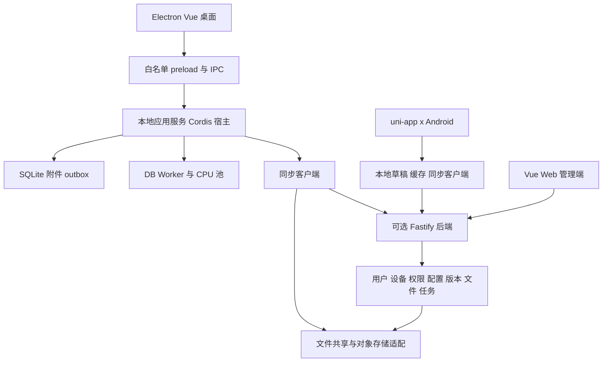

# 青春幻想引擎整体重构架构与实施方案

版本：设计基线 1.0，2026-10-14。现有源码基线为 3.0.2、提交 e6a8faf。用户已确认 Electron 桌面端、uni-app x 移动端、Cordis 插件内核，稳定好用优先，持续优化体积和性能。本文和配套文档描述目标开发方案，尚未实现新版业务代码。

## 正式技术选型

| 范围 | 确认方案 | 实施约束 |
| --- | --- | --- |
| 桌面宿主 | Electron | Windows、macOS、Linux；安全隔离、分平台安装与更新 |
| 桌面与 Web 前端 | Vue 3、TypeScript、Vite、Pinia | 简洁工作区与按需加载；已有 React 页面逐步迁移 |
| 编辑器 | CodeMirror 6 与自有 Editor Adapter | 纯文本兼容优先，中文输入和长文验收 |
| 业务核心 | TypeScript 模块化单体 | 桌面本地服务与后端共用模块，不依赖全局当前作品 |
| 插件内核 | Cordis + 自有 SDK、Manifest 和权限层 | 精确锁定来源/版本，生命周期与故障测试，隔离上游 API |
| 本机数据 | SQLite、事务、版本日志、outbox、附件目录 | 优先验证 better-sqlite3；数据库在本地磁盘 |
| 后端 | Node.js 24 LTS、Fastify 5、统一 OpenAPI | 用户、设备、权限、配置、文件、版本、任务和存储 |
| 移动 | uni-app x，仅 Android 首发 | 基础编辑、配置、同步、远程控制；UTS/Kotlin 原生能力 |
| 并发 | 异步 I/O、有界 worker_threads、持久任务 | main/renderer 不做 CPU 密集工作，写入有版本守卫 |
| 部署 | 官方版本镜像与 Compose | 飞牛 NAS、云端、本地 Linux，amd64/arm64 |

此前 Tauri、Rust 全量核心与 Axum 后端的首选建议已被本基线替代。Rust/Wasm 仅在实测或隔离需求成立后作为可选模块引入，不再作为全量重写前提。历史 Android Kotlin/Compose 独立客户端方案也已被 uni-app x 替代。

Cordis 官方当前明确说明 API 尚未稳定；本项目保留其生命周期选型，通过固定版本、适配器、自有 SDK 和发布门禁管理风险，不将上游框架描述为已经稳定的公共 API。详见[技术决策与官方资料](重构开发文档/13-决策与资料.md)。

## 完整技术与开发文档

统一入口为[重构开发文档](重构开发文档/README.md)。

| 专题 | 文档 |
| --- | --- |
| 总体架构与工程边界 | [01 总体架构](重构开发文档/01-总体架构.md) |
| 桌面进程、界面、编辑器和 IPC | [02 桌面与界面](重构开发文档/02-桌面与界面.md) |
| uni-app x、原生模块与后台同步 | [03 移动端](重构开发文档/03-移动端.md) |
| 用户、设备、权限与远程控制 | [04 后端与安全](重构开发文档/04-后端与安全.md) |
| Cordis、插件 SDK、主题与模板 | [05 插件内核与 SDK](重构开发文档/05-插件内核与SDK.md) |
| 实体、事务、附件和数据迁移 | [06 数据与本地存储](重构开发文档/06-数据与本地存储.md) |
| API、幂等、冲突与文件协议 | [07 同步协议与 API](重构开发文档/07-同步协议与API.md) |
| 多任务、多线程、检索与 AI | [08 任务与 AI](重构开发文档/08-任务与AI.md) |
| 飞牛、Docker、HTTPS 和恢复 | [09 部署与运维](重构开发文档/09-部署与运维.md) |
| 环境、工作区、目标命令和规范 | [10 开发规范与环境](重构开发文档/10-开发规范与环境.md) |
| 性能、故障、跨端、迁移和发布 | [11 测试验收与迁移](重构开发文档/11-测试验收与迁移.md) |
| 阶段、交付、依赖与工期预算 | [12 开发计划](重构开发文档/12-开发计划.md) |

## 架构关系

前后端分离是界面通过应用接口工作，不要求本地必须部署服务器。桌面本机调用经 IPC，后端调用经 HTTP，两者复用业务用例。手机共享协议、声明式资源和一致性样本，UI/原生能力分别适配。

## 关键产品边界

本地模式可建书、写作、管理和导出；NAS/互联网不可达不阻止本机保存。局域网和远程后端使用同一 API；文件直连提供经验证的变更交换，但不具备中心化账户、在线控制和实时撤销等全部能力。

同步区分本地保存与远端确认，使用事务、增量日志、幂等批次、墓碑和冲突队列。不同章节可独立同步，同章冲突保留双方内容。NAS 共享目录保存同步对象、附件或备份，不让多设备打开同一个 SQLite。同步与独立备份分别管理。

SMB、FTP/FTPS、SFTP、NFS、WebDAV 与 S3 通过 Provider 接入，按实际服务能力验收。NFS 优先宿主挂载，手机复杂协议优先经后端代理。DLNA 仅可选媒体浏览，不作为配置同步协议。

插件先支持可信内置功能和可导入声明式资源；主题、模板、工作流和面板贡献点可自由组合。第三方执行插件完成真实隔离和资源验证后开放，Node vm/Worker/独立进程不自动等于安全沙箱。手机不直接运行全部桌面插件，缺失能力可解释降级且保留数据。

界面默认围绕作品、写作、资料和任务四个入口；模型、同步和插件均非开始写作的必填项。AI 输出先成为建议稿，采用时校验正文基线；多项目任务固定目标，不跟随界面切换漂移。

## 开发与验收

P0 契约与基准 → P1 离线桌面 → P2 任务与 AI → P3 后端与同步 → P4 uni-app x → P5 协议与生态 → P6 三平台稳定发布。详细依赖、预算和完成条件见[开发计划](重构开发文档/12-开发计划.md)，任务状态见[实施清单](整体重构实施清单.md)。

Electron 自带运行时，不再采用原 Tauri 的 40 MB 包体目标。P0 测各平台完整安装包和全部进程成本，再设包体预算；初始争取冷启动可编辑 P95≤3 秒、并发输入处理 P95<50 ms、停止输入至本地确认 P95≤1 秒。指标均为待实测目标，不能作为已实现性能宣传。

旧版与新版分别使用数据位置，先导入副本和生成报告，通过正文、引用、附件与未知字段核对后由用户切换。数据库、同步协议、插件 API 和模板版本分开管理，升级前备份，旧程序不能直接写新库。
