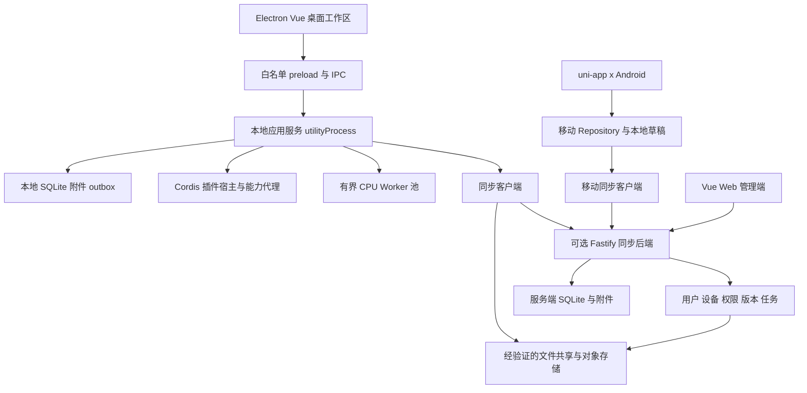

# 总体架构

## 目标与原则

采用模块化单体和端口适配器结构。业务规则不依赖 Electron、Vue、Fastify、uni-app x 或某个文件协议；界面调用应用命令，命令协调存储、任务和同步。桌面无需远程后端即可写作，远端失败不能阻断本地事务。

稳定优先意味着控制依赖、显式版本和可恢复数据，不等于保留全局单例和整库序列化。先完成一条可用链路，再迁移业务；不先把全部功能搬成空插件。

## 结构



桌面本地应用服务和后端复用 TypeScript 应用模块，使用不同 Repository、凭据与传输适配；不是复用同一个进程。手机共用 Schema、协议样本与声明式资源，纯 TypeScript 工具逐项验证兼容；原生模块另行实现。

## 运行模式

| 模式 | 保存与连接 | 能力边界 |
| --- | --- | --- |
| 本地 | SQLite + 附件 + 本地备份 | 完整桌面写作，手机支持已缓存内容与基础草稿；远程 AI 需网络 |
| 局域网文件直连 | 桌面经 SMB/NFS 挂载目录或 WebDAV 等交换变更 | 不依赖本项目后端；没有统一账户、在线设备控制和实时撤销 |
| 局域网后端 | NAS/Linux 后端协调增量、设备和资源 | 手机与桌面共用 API，配置简单优先 |
| 远程后端 | 云服务器或 NAS 外网入口，HTTPS | 与局域网同一 API，以 serverId 识别同一服务 |
| 远程文件直连 | WebDAV/SFTP/S3 等 | 经能力验证后启用双向同步；手机只支持声明的子集 |

每个工作区只有一个权威同步目标。内网 URL 与外网 URL 可指向同一个 serverId；更换目标是显式迁移，不让两个独立后端争夺权威。其他目标可作为备份。

## 模块依赖

| 模块 | 责任 | 不允许的依赖 |
| --- | --- | --- |
| contracts | JSON Schema、命令、错误、协议版本与样本 | UI、数据库运行时 |
| domain | 作品、正文、引用、版本与权限规则 | DOM、Electron、Fastify、SQL 驱动 |
| application | 用例、事务协调、事件和任务提交 | 具体页面或全局当前项目 |
| persistence | SQLite、附件、迁移、Repository | UI 状态 |
| jobs/ai | 持久任务、模型请求、上下文和计算执行器 | 直接重写界面正文 |
| sync/storage | 冲突、变更、游标、字节传输和能力探测 | 具体 UI 布局 |
| plugin-sdk/host | 清单、能力、注册、生命周期与配置 | 插件内部私有实现 |
| hosts | 桌面、后端、Web、手机的运行环境适配 | 反向修改领域规则 |

所有命令显式携带 workspaceId、projectId 和目标实体，写入携带 expectedRevision、requestId。授权主体由宿主提供，不能信任客户端 payload 中自报的角色。任务绑定不可变输入版本；切换作品不改变后台任务目标。

## 工程组织

```text
apps/
  desktop/              main preload renderer local-service
  admin-web/            Web 管理端
  mobile/               uni-app x 与 uni_modules 原生适配
services/server/        Fastify HTTP API 与服务端执行器
packages/
  contracts/            Schema DTO 错误码 样本
  domain/               纯领域逻辑
  application/          命令 查询 事务端口
  persistence-sqlite/   Repository SQL 与迁移
  jobs/                 状态机 队列 Worker 协议
  ai/                   Provider 上下文 检索 使用记录
  sync/                 幂等 合并 outbox 游标
  storage/              通道能力与驱动
  plugin-sdk/           面向插件的稳定契约
  plugin-host/          Cordis 适配与能力代理
  client-sdk/           IPC/HTTP 客户端与错误适配
  ui/                   Vue 基础组件 设计令牌
plugins/                内置角色 主题 导出等插件
templates/              字段 作品 工作流 配置档
deploy/                 镜像 Compose 反向代理
tools/                  契约生成 迁移 基准
```

使用 npm workspaces 与单一 lockfile，先复用现有 npm 环境。uni-app x 构建由受维护的 HBuilderX 工具链管理，若其插件结构不能直接作为 npm workspace，保留独立构建边界，契约产物从 packages/contracts 生成后复制校验；不为统一目录强改其打包器。

## 状态与通信

Vue/Pinia 保存选中项、面板、草稿显示和订阅状态，不保存整个作品库副本。数据库是已保存数据来源。事件只发布实体 ID、版本与最小差异，客户端按需重新查询；事件丢失后能从持久版本重新建立状态。

IPC 与 HTTP 共用命令语义和错误分类，传输封装不同。首版 REST 用于命令与查询，服务端事件优先 SSE；手机不具备稳定 SSE 能力时用带游标轮询。流事件用于通知，数据库与任务状态才是最终结果。

同一功能只在一个指定位置执行：桌面本机或后端。远程任务不自动退回本机重新调用模型，以免重复执行和计费。离线队列保留目标与状态，用户可显式重新提交。

## 兼容与版本

分别管理应用版本、databaseSchemaVersion、syncProtocolVersion、pluginApiVersion、资源模板版本。共享 API 支持能力协商，移动端不能理解的字段仍保留。破坏兼容前提供迁移、备份和拒写策略，禁止旧版直接写新版同步目录。

首个稳定版不引入微服务、Redis、强制外部数据库和常驻模型服务。Rust、Wasm、PostgreSQL 与额外执行器只有在测量或隔离需求成立时引入，不成为启动写作的前提。
